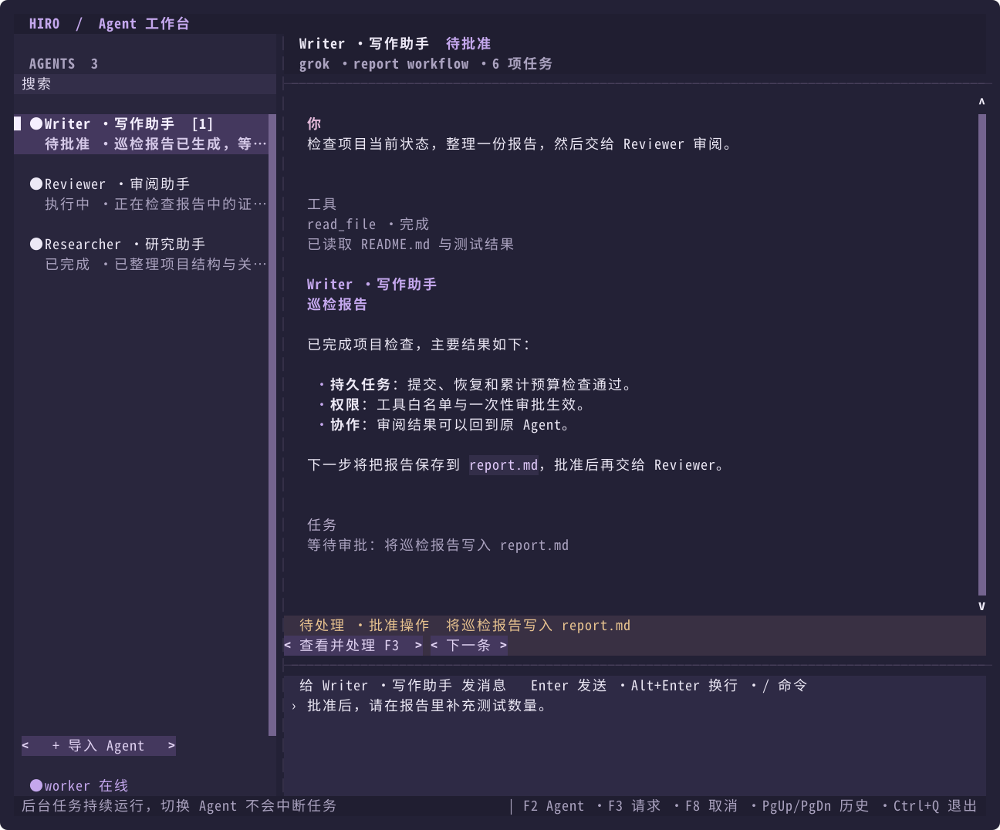

# hiro-agent

一个用 Python 手写的 Coding Agent Harness，通过 CLI 在本地项目中读取代码、修改文件、执行验证。

参考 [mini-dsh](https://github.com/huangjunsen0406/mini-dsh) 对核心运行机制的拆解，**用一个可以跑起来的项目理解 Agent Harness**。Hiro 自行实现服务容器与插件生命周期，核心保留五条清晰的链路：

1. **Context / Plugin / Service**：注册服务 → 检查依赖 → 管理资源生命周期。
2. **Session Event Log**：记录事件 → 派生模型消息 → 保存与恢复会话。
3. **Tool Registry / Executor**：注册工具 → 导出 schema → 校验、审批与执行。
4. **Model Adapter**：统一模型接口 → Chat Completions 兼容服务 / 离线 Mock。
5. **Agent Loop**：模型 → 工具 → 模型 → 最终回答。

在这条主链路上，Hiro 还实现了运行预算、JSONL 会话恢复和可选的只读子 Agent。默认运行单 Agent，普通工具顺序执行，真实模型默认流式返回；适合阅读源码、学习实现和扩展实验。

完整配置与恢复细节见 [使用与运行机制](docs/guide.md)。

## 最小 Bot 内核

最小内核提供持久 Bot 身份、任务执行、记忆和跨 Bot 交接，并保留现有单次 `AgentService` 和 CLI 行为。范围与接口见[需求](docs/kernel/REQUIREMENTS.md)和[接口契约](docs/kernel/CONTRACTS.md)，验证方式见[开发指南](docs/development.md)。

| 模块 | 能力 |
| --- | --- |
| 基础契约 | SQLite Bot 身份与配置、版本化工具白名单、执行端权限检查、Session 绑定及子 Agent 权限继承。 |
| 持久执行 | SQLite 持久任务、独立单 worker、审批/提问跨进程恢复、一次性授权与累计预算。 |
| 可重复工作 | Bot 独立记忆、任务摘要、工具配对完整的上下文压缩、文本 Skills、一次性与固定间隔触发。 |
| 跨 Bot 协作 | 双 Bot 持久交接与结果任务、跨 Bot 累计预算和交接次数限制。 |

Bot 配置通过可选 `bot` 字段启用，包含稳定 `id`、`name`、`instructions` 和 `allowed_tools`；省略该字段的旧配置保持兼容。持久数据位于工作区 `.hiro-agent/kernel.sqlite3`，原始执行日志仍保存在 `.hiro-agent/sessions/`。使用 `hiro-agent kernel` 管理 Bot、提交任务、启动独立 worker 和答复交互，具体命令见 [内核使用指南](docs/kernel/USAGE.md)。

`hiro-agent kernel agent-manager --source default -w /path/to/project` 可新增「Agent 管理员」，继承已有 Bot 的模型设置。向管理员描述需要的 Agent，它通过 `create_agent` 在审批后创建长期保留在 TUI 左侧的新身份，并可用 `list_agents` 查看已有 Agent。新身份只能获得创建者已有工具的子集，创建不会覆盖已有 ID。操作示例见 [TUI 指南](docs/tui.md)。

TUI 中可用 `/clear` 清空当前 Agent 的会话、任务和记忆，`/delete-agent` 删除当前 Agent，`/init-agents` 补齐 Hiro、Agent 管理员、代码编写员。终端对应 `kernel clear-history`、`kernel bot-delete`、`kernel init-agents`；清理与删除需要确认，初始化保留已有身份和历史。

审批挂起会结算旧调用，批准后在新 Run 中执行保存的精确操作；授权绑定任务、参数和权限版本，任务累计预算不会因续跑重置，等待不计执行时间。未知副作用进入 `needs_reconciliation`，不会自动重放。SQLite/JSONL 崩溃窗口与恢复边界见[接口契约](docs/kernel/CONTRACTS.md)。

`kernel memory-*` 管理每个 Bot 的记忆；每次请求重新读取当前记忆，删除不抹去历史审计。`kernel skill-*` 管理 Markdown 技能与成功任务草稿，正文通过白名单中的 `read_skill` 读取，技能不会扩展权限。`kernel routine-*` 管理一次性或固定间隔触发，所有触发经统一 Task 入口去重；独立 worker 在执行长任务时继续接收定时任务。

`send_handoff` 将工作交给另一 Bot，审阅结果通过关联任务回到原 Bot；`read_handoff` 和 `kernel handoff-result` 可读取结果。交接与回传任务使用同一份持久链预算，默认最多 8 次显式交接，回传不会自动形成下一轮互聊。支持定时巡检、等待审批、重启续跑、第二 Bot 审阅和原 Bot 处理结果的完整流程。

TUI 中的直接 Agent 通信使用 `send_message` / `read_message`，携带 `correlation_id`，通过真实持久消息、接收方执行和自动回复任务完成往返。新标准 Agent 和管理员具备通信权限；已有身份使用 `kernel enable-communication AGENT_ID` 开启并重启旧 worker。发送被接受与收到匹配回复分别核验，详见[通信示例](docs/kernel/USAGE.md#agent-直接通信)。

入口：`hiro-agent kernel --help`。完整配置与操作步骤见 [内核使用指南](docs/kernel/USAGE.md)。范围限定为单用户、本地单 worker；不承诺外部副作用恰好发生一次，结果未知时保留现场并要求显式核实。

## 环境

* Linux

* Python `>= 3.12`

* [uv](https://docs.astral.sh/uv/)（仓库 CI 使用 `0.9.15`）

## 快速开始

```bash
git clone https://github.com/curealb/hiro-agent.git
cd hiro-agent
uv python install 3.12
uv sync --locked --managed-python
uv run hiro-agent --help
```

### 先跑通：无需 API Key

```bash
mkdir -p /tmp/hiro-demo
uv run hiro-agent --mock --workspace /tmp/hiro-demo
```

交互终端会打开紫色全屏工作台，并提供 Demo A / Demo B 两个 Agent。输入任意任务，Mock 会演示完整的「模型 → 工具 → 模型」链路：

```text
用户输入
  → 读取 hiro-demo.txt
  → 请求批准写入 Hello from Hiro!
  → 请求批准运行 Python 验证
  → 回答结果
```

在 TUI 中按 `F3` 处理写入和命令审批；拒绝后演示停止。输入 `/chat` 可切换到传统聊天，也可用 `uv run hiro-agent chat --mock --workspace /tmp/hiro-demo` 启动，在审批时输入 `y` 批准。Mock 用于验证运行链路，不理解任意编程需求；请使用允许覆盖 `hiro-demo.txt` 的演示目录。

### 接入真实模型

选择支持 Chat Completions 文本和 function tools 的服务，在当前 shell 导出配置：

```bash
export HIRO_BASE_URL='https://your-provider.example/v1'
export HIRO_MODEL='your-tool-calling-model'
export HIRO_API_KEY='your-key'

uv run hiro-agent --workspace /path/to/your/project
```

`HIRO_BASE_URL` 填服务的 API 基址，程序会追加 `/chat/completions`。程序不会自动加载 `.env`，变量示例见 [.env.example](.env.example)。本地无鉴权服务也需要设置占位 API Key。

使用 JSON 配置启动：

```bash
uv run hiro-agent chat --config configs/baseline.json --workspace /path/to/your/project
```

完整配置见 [configs/baseline.json](configs/baseline.json)；`HIRO_BASE_URL`、`HIRO_MODEL` 可覆盖对应配置，`--mock` 强制使用 Mock。真实模式没有默认模型名，需要显式设置 `HIRO_MODEL` 或配置中的 `model.model`。

## 多 Agent TUI

在交互终端直接运行 `uv run hiro-agent`，默认打开紫色全屏工作台。在左侧搜索并切换持久 Agent，右侧查看各自对话、发送任务和处理审批。切换时保留各自的草稿，后台任务继续执行。

```bash
# 默认入口，或显式进入 TUI
uv run hiro-agent --workspace /path/to/your/project
uv run hiro-agent tui --workspace /path/to/your/project

# 无需 API Key 的双 Agent 演示
mkdir -p /tmp/hiro-tui-demo
uv run hiro-agent tui --demo --workspace /tmp/hiro-tui-demo

# 导入多个 Bot 配置，直接打开指定 Agent
uv run hiro-agent tui -w /path/to/your/project -c writer.json -c reviewer.json --agent writer
```



图片来自实际 TUI 渲染，内容为布局示例。鼠标点击 Agent 即可切换；键盘用 `F2`、`↑/↓`、`Enter`，或直接 `Alt+↑/↓`。`Enter` 发送，`Alt+Enter` 换行；`F3` 处理审批/提问，`F8` 多选或全选任务批量取消（待核实任务需统一填写核实说明并确认）。`F4` 或 `/select` 进入文字选择模式，拖选后用终端快捷键复制，`F4` / `Esc` 返回。`Ctrl+Q` 退出界面，已提交任务继续由独立 worker 执行。

输入 `/agent ID` 或 `/agent 完整名称` 切换 Agent，`/agent` 打开列表；输入 `/chat` 切换到传统聊天，再用 `/tui` 返回。导航命令支持补全，不会提交模型任务。同一次启动中，各 Agent 的传统聊天 Session 和 TUI 草稿都会保留。TUI 的持久任务汇总与传统聊天历史分别保存，不自动合并；切换不会移动或重放 worker 任务。

首次打开没有 Bot 的工作区时，会用旧配置、模型环境变量和权限设置创建 `default` Agent；已有 Bot 使用保存的配置，启动不会自动覆盖。单个不含 `bot` 的旧配置也可通过 `--config` 导入为 `default`，多个配置需分别提供稳定的 `bot.id`。

默认连接或启动独立 worker；`--no-start-worker` 关闭自动启动，`F6` 可手动启动。侧栏显示状态、最近消息、待处理数量和新活动提示；窄终端按 `F2` 打开列表、`Enter` 返回对话。更多操作及数据边界见 [TUI 使用说明](docs/tui.md)。显式 `chat`、`resume`、根命令的 `--resume` 和管道输入继续使用传统聊天。

## CLI

传统聊天可通过 `uv run hiro-agent chat` 或 TUI 内的 `/chat` 进入。交互终端使用独立的深色输入框，会话顶部显示模型、工作区与 Session。输入 `/` 后，命令及中文说明会显示在输入框上方，当前选项整行蓝色高亮。继续输入可筛选（如 `/co`），用 `↑` / `↓` 切换，按 `Enter` 执行；`Tab` 补全当前选项，`Esc` 收起菜单。也可以直接输入完整命令后回车。

```text
/help
/continue
/tasks
/resume
/agent
/tui
/chat
/exit
```

| 输入                  | 行为                          |
| ------------------- | --------------------------- |
| 普通任务描述              | 在当前 Session 创建新 Run         |
| `/help`             | 显示帮助                        |
| `/continue`         | 继续最近未完成的任务，使用新 Run 和新预算     |
| `/tasks`            | 查看当前 Session 最近一个 Run 的委派任务 |
| `/resume`           | 选择历史会话；也可用 `/resume SESSION_ID` 直接切换 |
| `/agent`            | 列出可用 Agent；`/agent ID` 或 `/agent 完整名称` 切换，名称重复时使用 ID |
| `/tui`              | 切换到全屏工作台，并保留当前传统聊天 Session |
| `/chat`             | 在传统聊天中保持当前 Session；在 TUI 中切换到传统聊天 |
| `/exit` 或空闲时 Ctrl+D | 退出                          |
| 空闲时 Ctrl+C          | 清空当前输入                      |
| 执行或审批时 Ctrl+C       | 取消当前 Run，清理后返回输入提示          |

修改文件和执行命令前会展示操作并请求批准。仅 `y` / `yes` 授权本次操作，回车、`n` 或 EOF 均表示拒绝。

执行任务时，交互终端会逐步显示模型回复，并展示动态状态栏：当前阶段、耗时、输入/输出 Token、缓存命中数量与比例。用量包含只读子 Agent，在每次响应的最终 usage 返回后更新，任务结束后保留汇总。服务未返回用量或缓存字段时显示“未提供”，部分响应缺失时标明统计不完整。审批期间动画暂停，返回执行后恢复。

模型回复支持 Markdown 渲染，包括标题、粗体、列表、表格、行内代码和带语法高亮的代码块。流式预览也会渲染 Markdown；超长回复在生成期间使用纯文本尾部预览，结束后渲染完整正文。管道和重定向输出保留原始 Markdown。

真实模型默认使用 SSE 流式请求；不支持流式的服务可在 JSON 配置中设置 `model.stream: false`。工具调用收齐后才执行，断流或取消时不会执行未完成的工具调用。Mock 仍返回完整的脚本化演示结果。

## 会话与恢复

Session 保存跨轮次的对话与事件；Run 是一次任务执行，拥有自己的状态和预算。同一个 Session 可以包含多个 Run。

会话自动保存在工作区的隐藏目录 `.hiro-agent/sessions/`，退出后仍保留；未指定 `--workspace` 时使用当前目录。本仓库的 `.gitignore` 已忽略 `.hiro-agent/`。选择或恢复历史会话：

```bash
uv run hiro-agent resume                         # 方向键选择历史会话，Enter 恢复
uv run hiro-agent resume --last                  # 恢复最近有任务记录的可读取会话
uv run hiro-agent resume SESSION_ID              # 直接恢复指定会话

# 指定工作区，或继续使用原有 --resume 方式
uv run hiro-agent resume --workspace /path/to/your/project
uv run hiro-agent sessions --workspace /path/to/your/project
uv run hiro-agent tasks --session SESSION_ID --workspace /path/to/your/project
uv run hiro-agent chat --resume SESSION_ID --workspace /path/to/your/project
```

聊天中输入 `/resume` 也可选择历史会话，`/resume SESSION_ID` 直接切换，`/resume --last` 切换到最近的其他会话。列表显示更新时间与首条任务摘要，省略没有任务的空会话。交互终端使用 `↑` / `↓` 选择、`Enter` 恢复，`Esc` / `Ctrl+C` 取消；支持 `Home` / `End` 和 `PageUp` / `PageDown` 浏览较长列表。

按 `Delete` 或 `d` 删除选中的历史会话，界面显示会话信息后，按 `y` 确认，`Enter` / `n` / `Esc` 取消删除。删除会移除此会话及关联子会话的历史记录，无法撤销；工作区中的项目文件保持原样。正在使用的会话不能删除。非交互输入仍可用序号或完整 ID 选择，`d 序号` 发起删除，确认时输入 `y` / `yes`，空输入取消。

恢复后显示历史对话并等待用户输入；用 `/continue` 继续未完成任务，或直接输入新任务并保留完整上下文。恢复本身不会请求模型或重跑工具。继续使用原来的模型配置启动，例如 Mock 会话加 `--mock`，配置文件加 `--config`。`tasks` 查询整个会话的委派记录，可追加 `--run RUN_ID` 筛选。

工具开始和结果事件落盘后才继续推进；恢复根据调用 ID 配对结果。旧工具调用不会自动重跑，结果未知的操作需要先核实。日志包含任务、工具参数及输出，在目标项目中应将 `.hiro-agent/` 加入 `.gitignore`。

## Agent Loop 什么时候结束？

理解主循环时，可以先忽略预算、审批与日志细节，只看这段伪代码：

```python
while True:
    messages = derive_messages(session.events)
    response = await model(messages, tool_schemas)
    record_assistant(response)

    if not response.tool_calls:
        return response.content

    await execute_tools(response.tool_calls)
```

工具结果写回会话，再派生下一轮模型消息。模型正常返回且不再请求工具时，当前 Run 完成；具体实现见 [agent.py](src/hiro_agent/agent.py)。

Hiro 还为循环设置了可配置的预算，防止错误的模型或工具链一直运行：

| 每个 Run 的预算        | 默认值   |
| ----------------- | ----- |
| 模型请求次数            | 64    |
| 工具受理次数            | 128   |
| 总运行时间（包含模型、工具和审批） | 600 秒 |

预算耗尽、上下文超限或模型输出被长度限制截断时暂停；截断响应中的工具不会执行。Ctrl+C 取消当前 Run，模型请求或主循环异常会结束当前 Run 并记录失败。暂停后可用 `/continue` 在新 Run 中继续，并获得新预算。参数错误与权限拒绝也计入工具预算。

上述 `/continue` 行为属于原交互式 `chat/resume` 入口。`kernel` 持久 Task 使用跨 Run 累计预算，审批或提问等待不计执行时间，续跑不会获得新的总额度。

## 只读子 Agent

通过 `--subagents` 开启委派，模型按任务需要选择角色：

| 角色         | 职责            | 可用能力       |
| ---------- | ------------- | ---------- |
| `explorer` | 定位实现、调用关系和测试  | 列举、读取、搜索文件 |
| `reviewer` | 静态审查代码并提出验证建议 | 列举、读取、搜索文件 |

```bash
# 真实模型
uv run hiro-agent --subagents --workspace /path/to/your/project

# 离线演示：读取 / 写入 / 验证 → 并行探索与审查 → 汇总
mkdir -p /tmp/hiro-subagents-demo
uv run hiro-agent --mock --subagents --workspace /tmp/hiro-subagents-demo
```

每个子任务使用独立 Session，只接收任务描述和角色提示，返回带文件证据的 JSON 报告。默认并发为 2，可配置为 1–8；同一轮相邻的委派可以并行，普通工具仍按顺序执行。仅支持一层委派，子 Agent 不能写文件、运行命令或继续委派。

父子共享主任务预算，每个子任务另有 16 次模型请求、32 次工具受理的局部上限。角色模型、预算与暂停恢复示例见 [详细指南](docs/guide.md#只读子-agent)。

## 工具

| 工具              | 用途                    |
| --------------- | --------------------- |
| `list_files`    | 列举工作区文件               |
| `read_file`     | 按行读取文本                |
| `search_text`   | 搜索纯文本，返回匹配位置          |
| `write_file`    | 创建或覆盖文件，需批准           |
| `edit_file`     | 精确匹配替换，需批准            |
| `run_command`   | 执行程序及参数，需批准           |
| `delegate_task` | 启用子 Agent 后，委派探索或审查任务 |

文件工具检查工作区边界、符号链接并限制输出大小。命令通过可执行文件和参数运行，不隐式调用 shell；取消或超时会终止并回收所属进程组。

批准的命令拥有当前操作系统用户的权限，工作目录并非 OS 沙箱。运行不可信代码应使用独立隔离环境。

## 最重要的心智模型

```text
                 Context / Plugin / Service
                 服务注册、依赖与资源生命周期
                            │
      ┌──────────┬──────────┼──────────┬──────────┐
      ▼          ▼          ▼          ▼          ▼
   Session     Model      Tools    Permission   Agent
   事件日志    兼容接口    注册与执行   审批策略     主循环
   JSONL       Mock         │
                       ┌────┴─────────────┐
                       ▼                  ▼
                    文件 / 命令       delegate_task（可选）
                                      ├─ explorer
                                      └─ reviewer

运行链路：CLI → Agent Loop → 历史消息 → Model → Tools → 下一轮
```

**Agent Loop 通过统一的服务契约调用模型、工具与会话。** 文件读写和命令执行的具体实现留在工具层；子 Agent 也通过 `delegate_task` 接入这条工具链路。

服务容器的 `Context` 位于 [core.py](src/hiro_agent/core.py)，负责装配与生命周期；[context.py](src/hiro_agent/context.py) 中的上下文服务负责历史消息投影与任务预处理。理解这两个职责，再阅读循环会更清楚。

替换模型、工具或会话实现时，实现对应 Protocol，再通过插件注册服务；工具调用经过统一 Executor 完成校验、预算、审批与结果记录。当前插件是项目内的服务装配机制，尚未接入 MCP。

## 当前边界

* 持久 Bot 支持任务摘要和上下文压缩，原始 JSONL 始终保留；原交互式入口仍使用完整历史。

* 仅支持文本，支持流式与完整响应；网络请求不自动重试。

* 子 Agent 只读，共用工作区，无文件系统快照。

* 恢复不回滚文件，也不保证外部副作用恰好发生一次。

* 尚无 MCP 集成、HTTP API、Web UI、Benchmark 或可写子 Agent。

## 开发与验证

```bash
uv sync --locked
uv run --locked ruff check .
uv run --locked ruff format --check .
uv run --locked mypy src
uv run --locked pytest -q
uv build
```

测试使用临时工作区、Mock 模型和 HTTP MockTransport，无需真实 API Key。覆盖模型适配、工具审批、预算、取消、子进程回收、并行委派、会话锁与日志恢复；CI 执行相同检查。
