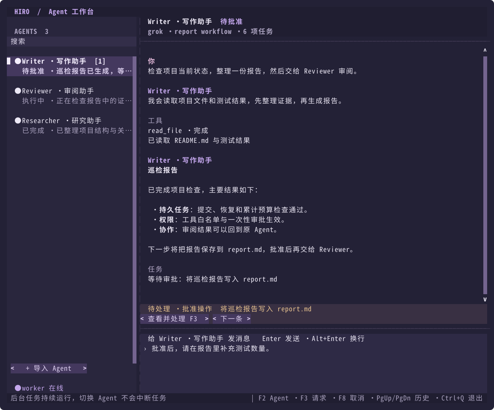

# 多 Agent 终端工作台

在交互终端运行 `hiro-agent`（不带子命令）会打开紫色全屏工作台，也可显式使用 `hiro-agent tui`。左侧的 Agent 对应持久 Bot；每条新消息通过统一 Task 入口提交，右侧按 Bot 汇总最近 30 个任务的对话。普通工具、审批、预算和恢复规则沿用持久内核。任务仍由本地单 worker 依次执行；界面可自由切换，不会增加执行并发或中断正在运行的任务。

## 启动

```bash
uv run hiro-agent --workspace /path/to/project
hiro-agent tui --workspace /path/to/project
hiro-agent tui -w /path/to/project --config writer.json --config reviewer.json --agent writer
hiro-agent chat --workspace /path/to/project
```

工作区需要已经存在。在启动目录或工作区的 `.env` 中填写 `HIRO_API_KEY`、`HIRO_BASE_URL`、`HIRO_MODEL` 后即可启动，无需手动编辑 JSON。已导出的环境变量优先，其次工作区 `.env`，再其次启动目录 `.env`。首次打开没有 Bot 的工作区时，程序会创建稳定 ID 为 `default` 的 Agent，沿用旧配置、`HIRO_MODEL` / `HIRO_BASE_URL`、工具权限及 `--subagents` 设置。已有 Bot 的工作区直接使用保存的配置和权限，不会因启动时的默认值或环境变量自动覆盖。

`tui --config` 可重复指定；多个配置均需有稳定的 `bot.id`。单个不含 `bot` 的旧配置可导入为 `default`。也可在界面中按 `F7` 或点击「导入 Agent」读取带 `bot.id` 的配置文件。显式导入相同 ID 按已有 BotStore 规则更新配置与权限版本，切换 Agent 本身不会更改配置。

也可以添加「Agent 管理员」，用自然语言创建长期保留在左侧的 Agent。先从已有 Bot 继承模型与工具权限：

```bash
hiro-agent kernel agent-manager --source default -w /path/to/project
hiro-agent tui --agent agent-manager -w /path/to/project
```

向它输入「创建一个叫代码审查员的 Agent，只允许阅读和搜索文件，重点检查权限问题」。管理员会调用 `create_agent`，审批界面展示新 Agent 的名称、职责和工具权限；批准后侧栏自动出现新 Agent，选择它即可开始对话。`list_agents` 可查看已有名称和 ID。管理员也可在绑定该 Bot 的传统聊天中使用这些工具。

新 Agent 继承创建者的模型、预算和工具配置，只能获得创建者已有工具的子集，可进一步收紧为 `read-only`。只有显式获得 `create_agent` 且允许写入的 Agent 才能继续创建 Agent；`delegate_task` 仍只创建临时只读子任务。创建不会覆盖已有 ID，也不会自动向新 Agent 提交任务。重复运行安装命令不会覆盖管理员；可用 `--bot-id`、`--name` 创建另一个管理角色。更新代码后，需要重启已经在运行的 worker 才能加载新工具。

Agent 间直接通信使用 `send_message` / `read_message`，通过持久消息 ID 和 `correlation_id` 关联真实收发。需要通信的角色应获得 `list_agents`、`send_message`、`read_message`；新安装的管理员可以授予这些工具。已有身份可用 `hiro-agent kernel enable-communication AGENT_ID -w /path/to/project` 开启，保留原配置和历史。发送后当前阶段先结束，worker 随后运行接收方，再自动为发送方提交回复核验任务；已接受发送不等于测试通过。完整 `comm-001` 示例见[直接通信指南](kernel/USAGE.md#agent-直接通信)。

收到 Agent 消息时，标题显示发送方的真实名称及“消息”或“回传”，使用青色；人工输入仍显示粉色“你”。名称根据持久任务的来源关系和已保存的 Agent 配置获取，消息正文不能伪造标题身份。找不到名称时显示来源 ID；来源已不可用时仍标为 Agent，不会显示成人工输入。重新打开 TUI 后，已有通信记录也会按此方式显示。

离线体验：

```bash
mkdir -p /tmp/hiro-tui-demo
hiro-agent tui --demo -w /tmp/hiro-tui-demo
```

`--demo`（亦可写 `--mock`）添加 `demo-a` 和 `demo-b` 两个脚本化演示 Agent，不覆盖已有同 ID 配置。它们演示读取 `hiro-demo.txt`、请求批准写入和验证，不理解任意编程任务。写入仍需批准；真实模型使用各 Bot 保存的完整配置和凭据环境变量。

TUI 需要 stdin 和 stdout 都连接交互式 Linux 终端，支持鼠标点击与滚轮。不带子命令时，重定向或管道会继续使用传统聊天；`chat`、`resume` 和根命令的 `--resume SESSION_ID` 也继续进入传统聊天。

对话区使用连续的深紫底色，空行与行尾保持一致；消息之间留白，正文最长 100 列，工具和任务提示使用较淡的文字。终端通过 `COLORTERM=truecolor` / `24bit` 或 `TERM` 的 `-direct` / `-truecolor` 后缀声明真彩色支持时，界面会使用完整紫色配色；否则沿用终端色深。显式的 `PROMPT_TOOLKIT_COLOR_DEPTH` 和 `NO_COLOR` 设置优先。

## 切换和交互

| 操作 | 行为 |
| --- | --- |
| `/目标Agent 消息内容` 或 `/ 目标Agent 消息内容` | 指定当前 Agent 本次要联系的通信对象，保持当前对话；通信/测试标识自动生成 |
| `/Agent1 /Agent2 消息内容` | 同时指定多个通信对象，逐一发送并分别核验、汇总回复；同一目标重复指定会去重 |
| `/agent ID` 或 `/agent 完整名称` | 切换 Agent；重名时使用完整 ID，未知目标保留当前 Agent |
| `/agent` | 打开左侧 Agent 列表；传统聊天中列出可用 Agent |
| `/chat` | 切换到当前 Agent 的传统聊天 |
| `/tui` | 切换到全屏工作台；已在 TUI 时保持当前界面 |
| `/help` | 查看命令帮助；`/` 菜单提供通信对象和命令补全，`/agent` 用于切换对话 |
| F4 / `/select` | 进入文字选择模式，拖选后用终端快捷键复制；F4 / Esc 返回 |
| 点击工具结果标题 / F5 | 展开或收起单项工具输出；F5 展开或收起当前 Agent 的所有工具结果 |
| 点击左侧 Agent | 立即切换对话，保留当前未发送草稿 |
| F2，↑/↓，Enter | 聚焦左侧列表、选择 Agent、回到输入框 |
| Alt+↑ / Alt+↓ | 在列表中直接切换 Agent |
| 点击搜索框输入 | 按名称、ID 或模型筛选；Tab/Shift+Tab 切换焦点 |
| Enter | 在主输入框发送任务 |
| Alt+Enter / Ctrl+J | 在主输入框换行 |
| PgUp / PgDn / 滚轮 | 浏览对话；Ctrl+End 回到最新消息并恢复跟随 |
| F3 / 查看并处理 | 查看完整待批准工具与参数，或回答问题 |
| F6 | 连接或启动独立 worker |
| F7 / 导入 Agent | 导入或更新 Bot JSON 配置 |
| F8 | 多选或全选任务，批量取消；待核实任务需填写核实说明 |
| Esc | 关闭弹窗，或从 Agent 列表回到输入框 |
| Ctrl+C | 清空当前输入，不取消后台任务 |
| Ctrl+Q / 空输入时 Ctrl+D | 退出 TUI，不停止 worker |

侧栏显示最近消息、任务状态、待处理请求数量；其他 Agent 出现新活动时显示圆点提示。未发送的消息草稿按 Bot 分开保存在本次界面会话中，问题答复草稿按请求分开保存。弹窗打开期间不会切换到其他 Agent；提交、答复和取消均绑定打开时的 Bot 与目标任务/请求，后台刷新不会改变操作归属。

例如在「通信测试发送方」对话中输入 `/通信测试应答方 重新测试一下`（也支持 `/ comm-test-responder 重新测试一下`），表示让当前发送方联系应答方。系统自动提供本次通信/测试标识，当前 Agent 使用真实消息工具发送并在回传后核验，不再需要手填唯一标识。输入 `/应答` 可在菜单中选中通信对象；回车只补全目标，继续输入正文后再回车发送，不会切换对话。只有 `/agent 名称或ID` 执行对话切换。传统聊天中的定向消息同样提交持久通信任务，可通过 `/tui` 查看异步回复。

需要多个 Agent 时，连续指定目标，例如 `/代码编写员 /代码审查员 一起检查这个问题`，或 `/ code-writer / code-reviewer 一起检查这个问题`。选完第一个目标后再输入 `/`，菜单会列出尚未选中的 Agent；选择第二个目标会保留第一个目标，补完正文后发送。每个目标使用独立的自动标识，分别调用真实消息接口；回传时可以读取同一批消息的结果，部分完成、失败或未发送的目标会单独列出，全部回复后再汇总。后台仍由单 worker 依次执行。目标列表后是共同任务说明，也可以在说明中给不同 Agent 分工。目标名称可含空格；正文需要以路径或斜杠开头时，使用 `--` 分隔，例如 `/代码审查员 -- /tmp/report.md`。

F8 打开当前 Agent 的任务多选列表，默认不勾选。用 `↑/↓` 移动、空格勾选，或用 `Tab` 切换到「全选」「全不选」按钮，最后点击「取消所选任务」。全选只包含本次列表中的任务，不会包含其他 Agent 的任务或随后新提交的任务。

所选任务中包含待核实任务时，会统一打开「核实并取消任务」弹窗。逐项检查文件或外部操作的实际结果并填写核实说明，再点击「确认核实并取消」；同一说明会保存到每项待核实任务。确认前按 `Esc` 或「返回」不会执行任何取消。取消不会撤销已有改动。批量处理会显示已取消、已请求停止及失败的数量，单项失败不会阻止其余项；已被其他入口重试的待核实任务不会被取消。当前 Agent 的所有运行中和待核实任务结束后，可用 `/clear` 清空历史。

工具结果默认折叠为名称和执行状态，点击带 `▸` / `▾` 的标题查看或收起完整输出；同次启动中刷新、切换 Agent 会保留展开状态。每项任务末尾显示累计输入、输出 Token、缓存命中数和命中率，运行中随已保存的用量刷新。等待模型返回或服务商未提供统计时会明确标注；缺失的缓存数据不会计作零命中，只有部分请求提供统计时显示「部分」。

需要复制对话时，按 `F4` 或输入 `/select`：界面临时隐藏侧栏、关闭鼠标捕获并暂停显示刷新，再用鼠标拖选文字，使用终端自己的复制快捷键（Linux 终端通常是 `Ctrl+Shift+C`）。此模式中仍可用 `PgUp` / `PgDn` 翻页，按 `F4` 或 `Esc` 返回后恢复实时显示；按 F4 进入会保留未发送草稿。后台任务继续运行，界面不会自行改写系统剪贴板。平时也可尝试按住 `Shift` 拖选，让终端绕过应用的鼠标捕获，具体取决于终端设置。选择范围限于终端已显示的内容，需要复制更早的内容时先翻到对应位置。

在同一次启动中，可以反复用 `/chat`、`/tui` 切换界面，并在传统聊天中用 `/agent ID或完整名称` 切换 Agent。每个 Agent 保留各自的传统聊天 Session，返回 TUI 后保留各自的草稿；重复进入当前界面的命令不会另开会话。导航命令不会发送模型任务。

不带 Bot 身份的旧版聊天首次切到 TUI 时，会保留原配置和权限建立对应 Agent；若工作区已有 `default`，会为这段聊天分配独立身份，避免混入已有 Agent 的指令或权限。

TUI 显示持久 Task 的汇总，传统聊天显示对应 Session 的历史，两种历史分别保留，不自动合并。切换界面不会把 worker 的任务 Session 当作传统会话恢复，也不会移动或重放已提交任务。重新启动后，传统会话仍可通过 `resume` 或 `/resume` 显式恢复。

审批弹窗先展示工具名与完整参数，可滚动查看；「批准一次」只答复该持久交互，执行端仍验证当前权限版本和精确操作。多个待处理请求可点击「下一条」。拒绝与问题答案同样持久保存，worker 重启后可继续处理。

窄于 78 列时，列表和对话分别显示，使用 F2 打开列表、Enter/Esc 返回对话。宽终端同时显示两栏。

## 清空历史、删除与默认 Agent

在下方输入框中输入命令即可管理当前选中的 Agent，命令不会发送给模型：

| 命令 | 行为 |
| --- | --- |
| `/clear` | 确认后删除当前 Agent 的任务、所有绑定会话及子会话日志、记忆和任务摘要，保留身份、模型、角色与工具配置 |
| `/delete-agent` | 确认后删除当前 Agent 及其历史、记忆、专属定时任务和技能启用设置 |
| `/init-agents` | 补齐 Hiro（`default`）、Agent 管理员（`agent-manager`）、代码编写员（`code-writer`），已有 Agent 的配置和历史不变 |

例如，在 Agent 管理员中完成一次创建后，输入 `/clear` 并确认，再提交新的创建要求。持久任务本来就使用独立 Session，但旧任务摘要会成为后续任务的参考记忆；清空会同时移除这部分上下文。清空后的下次任务从新的会话开始；从 TUI 返回传统聊天时，也不会继续使用已删除的旧会话。

清空或删除会丢弃尚未执行、正在等审批或答复的本 Agent 任务；若有正在执行、结果待核对、仍被其他传统聊天占用的会话，或有关联的其他 Agent 未完成任务，操作会拒绝执行并说明原因。先结束相应任务或关闭占用会话，再重试。在线但空闲的新版 worker 可以正常配合清理。项目文件与共享技能文件不属于聊天历史，不会被删除；清空保留定时任务定义，删除 Agent 则移除这些定义。

初始化从已有 Hiro 优先继承模型设置。工作区已没有任何 Agent 时，使用 `.env` 中的 `HIRO_MODEL`、`HIRO_BASE_URL` 等环境配置；也可在终端使用 `kernel init-agents --config /path/to/model.json -w /path/to/project` 指定模型配置。新建配置保存到 `.hiro-agent/kernel.sqlite3`，密钥由环境提供；传统聊天也支持 `/init-agents`。清理、删除和初始化同样提供终端命令，见[内核指南](kernel/USAGE.md#清空-agent-历史与删除-agent)。

## 后台任务和恢复

默认检查工作区 worker 锁：已有 worker 时直接连接，没有时启动独立进程。退出或切换 TUI 不会取消已提交任务。仅连接、不自动启动：

```bash
hiro-agent --no-start-worker -w /path/to/project
hiro-agent tui --no-start-worker -w /path/to/project
```

worker 离线时仍可保存任务和答复，启动后恢复处理；启动失败会显示提示，进程输出保存在工作区 `.hiro-agent/worker.log`。单 worker 的既有 OS 锁防止多个界面启动重复执行器。手工管理 worker 仍使用 [内核使用指南](kernel/USAGE.md)中的命令；TUI 的退出键只关闭界面。

消息区自动刷新，无需按回车。真实模型开启流式请求时，回复以「生成中」状态逐步显示，收到完整回复后在原处替换预览；断流或取消时保留片段并标注「输出中断（未完成）」。未完成片段不进入后续模型对话，也不用于执行工具。`model.stream: false` 或不支持流式的模型仍在完整返回后显示。

显示层对活动日志取只读快照，只解析完整落盘的行，不取得执行锁，也不修复、恢复或截断日志。流式文字也来自 worker 实际收到并批量保存的片段。缓存仅用于显示；提交、答复、取消始终重新通过服务校验。读取损坏日志会显示错误并保留可用的任务内容。更新流式显示功能后，需重启 TUI 和独立 worker。

结果为 `needs_reconciliation` 时，仍需使用 `kernel resolve` 记录人工核实说明；TUI 不会自动重试未知副作用。历史记录、任务和权限的持久语义见 [接口契约](kernel/CONTRACTS.md)。


